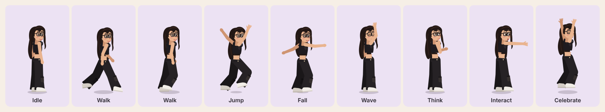

# Character asset plan

Official reference: [`docs/character/aastha-character-sheet.webp`](character/aastha-character-sheet.webp) (the Aastha Digital Avatar board).

## What is implemented now

The playable character is an **articulated 2D rig** (`src/character/rig.js`). It is drawn from separate parts (back hair, both legs with cargo trousers and sneakers, midriff, crop top, head, face, front hair, glasses, nose ring, earring, neck headphones, both arms) attached to a skeleton. Each animation (`src/character/poses.js`) moves the joints over time, so the motion is real limb movement: no stretched, squashed or rotated still image.

| Animation (spec §2) | Status | Where it's used |
|---|---|---|
| Idle | Done: breathing, blinking, hair sway, glances | Default |
| Walking left / right | Done: opposing leg and arm swing, knee fold, bob | Movement (left is mirrored) |
| Jumping | Done: separate rise, fall and landing poses | Jump, cloud climbing, bouncy bed |
| Waving | Done | Game start, the mirror, clicking the character |
| Thinking | Done: hand to chin, eyes up | Opening a "content pending" object |
| Interacting | Done: reach forward | Opening objects, using doors |
| Celebrating | Done: arms up, hop, confetti | Hidden bed bounce, opening everything |
| Sitting | Not implemented | Needs seat placement in rooms |
| Working | Not implemented | Needs the sitting pose plus a typing loop |
| Laughing | Not implemented as its own clip | Face shapes exist (`eyes: 'happy'`, `mouth: 'open'`) |

### Kept from the reference
Long dark wavy hair with a curtain fringe; black rectangular glasses; small nose ring; stud earrings; warm complexion with blush; black crop top; wide black cargo trousers with side pockets; white sneakers; headphones around the neck.

### Known gap: this is an interim art style
The reference is a soft, painterly 3D-style illustration. The rig is flat vector art drawn in code. It is recognisably the same person in outfit and identifying features, but it does not reach the sheet's rendering quality, and the face is far simpler. DIGITAL_ME.md asks that the character "feel like a stylized illustrated version of me". That is only partly met until illustrated frames replace it.

## What is needed for final illustrated sprites

A single character sheet can't be cut into animation frames: it has three static turnaround views and close-up expressions, and no in-between poses. Final art needs new illustrated frames, all side-on (facing right; left is mirrored), on transparent backgrounds, with consistent lighting and scale.

| Clip | Frames | Loop | Notes |
|---|---|---|---|
| Idle | 6–8 | yes | Breathing; one blink frame |
| Walk | 8 | yes | Full contact–passing–contact cycle |
| Jump | 3 | no | Take-off, rise, fall (+1 landing squash) |
| Wave | 6 | partly | Raise, 3–4 wave frames, lower |
| Think | 4 | hold last | Hand to chin |
| Interact | 4 | no | Reach out and return |
| Celebrate | 6 | yes | Arms up, small hop |
| Sit | 2 | hold | Sit down, seated |
| Work | 4 | yes | Seated typing |
| Laugh | 4 | yes | Matches the "Laughing" expression on the sheet |

**Spec:** about 340 × 480 px per frame (2× display size), feet on a fixed baseline at y ≈ 456 and the body centred at x = 170. Deliver PNG frames or a packed sprite sheet with JSON (TexturePacker / Aseprite).

**Integration:** `Player.js` already chooses a clip name each frame (`idle`, `walk`, `jump`, `land`, `wave`, `think`, `interact`, `celebrate`). Replacing the rig with sprite frames means loading the sheet in `WorldScene.preload`, defining Phaser animations with those names, and playing them in place of `renderPose()`. The game logic doesn't change.

**How to get the frames:** commission a 2D illustrator, or generate candidates with an image model from the reference sheet and clean them up by hand. Generated frames rarely stay consistent between frames without manual correction, so plan for that.
